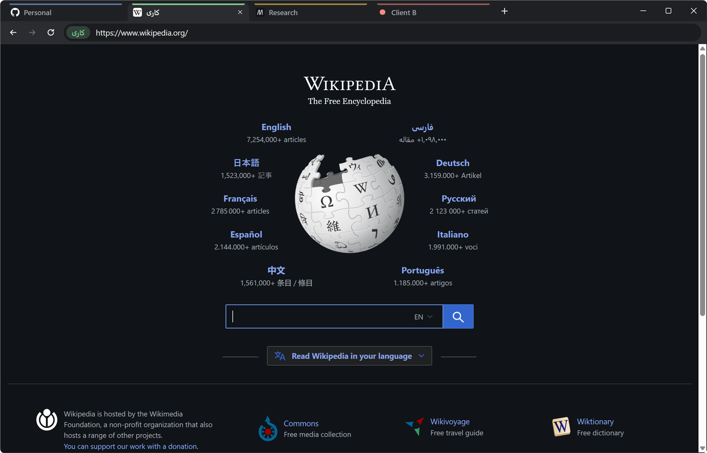

# IsoTabs

A Chromium (Electron) browser where **every tab is its own isolated browser**: its own cookies, logins,
localStorage/IndexedDB, cache and service workers. Nothing is shared between tabs, and each tab's data is
kept on disk and restored on restart. Every tab has a name and color you choose.



## Download

Get the latest build from [Releases](https://github.com/Geeknux/IsoTabs/releases/latest):

- **Windows:** `IsoTabs-<version>-portable.exe`, a single file with no install
- **Linux:** `IsoTabs-<version>-x86_64.AppImage` (see [Linux](#linux-appimage) below)

## Run from source

```bash
npm install
npm start
```

## Build a standalone exe

```bash
npm run dist
```

Produces `dist/IsoTabs-<version>-portable.exe` (single file, no install). The portable exe unpacks itself to a temp
folder on every launch, so it takes ~15–20 s to open; `dist/win-unpacked/IsoTabs.exe` starts instantly if you
copy that whole folder instead. The exe is not code-signed, so Windows SmartScreen warns on first run
("More info" → "Run anyway"). The icon source is `build/icon.svg`.

## Linux (AppImage)

Build on Windows with Docker (uses the official `electronuserland/builder` image):

```bash
npm run dist:linux:docker
```

On a Linux machine, `npm run dist:linux` does the same without Docker. Output: `dist/IsoTabs-<version>-x86_64.AppImage`.

Run it:

```bash
chmod +x IsoTabs-1.0.1-x86_64.AppImage
./IsoTabs-1.0.1-x86_64.AppImage
```

- If it complains about FUSE, install `libfuse2t64` (Ubuntu 24.04) / `libfuse2` (22.04), or run it with
  `APPIMAGE_EXTRACT_AND_RUN=1`.
- **Sandbox:** Chromium's sandbox needs unprivileged user namespaces. Ubuntu 23.10+ blocks them with AppArmor, so
  there the AppImage starts with the sandbox off and shows a red **No sandbox** badge in the toolbar. To turn it on:
  `sudo sysctl -w kernel.apparmor_restrict_unprivileged_userns=0` (to keep it after reboot, put
  `kernel.apparmor_restrict_unprivileged_userns=0` in `/etc/sysctl.d/60-userns.conf`). This relaxes a system-wide
  hardening setting, so decide whether that trade-off suits your machine.
- Data lives in `~/.config/IsoTabs`. Saved session cookies are encrypted with the desktop keyring
  (GNOME Keyring / KWallet) when one is available, same as Chrome.

## Use

| Action | How |
| --- | --- |
| New isolated tab | `Ctrl+T` or `+` (you're asked to name it right away) |
| Rename a tab | `F2`, double-click the tab, or right-click → Rename |
| Change color / clear data | Right-click the tab |
| Close a tab | `Ctrl+W`, `×`, or middle-click (**deletes all of that tab's data**) |
| Reorder | Drag a tab |
| Address bar | `Ctrl+L` |
| Switch tabs | `Ctrl+Tab`, `Ctrl+1…9` |
| DevTools | `F12` |

Shortcuts use physical keys, so they also work with a Persian keyboard layout.

## How it works

- Each tab uses an Electron partition `persist:tab-<id>`, stored in `%APPDATA%\IsoTabs\Partitions\tab-<id>`.
- Tab names, colors, order and URLs are in `%APPDATA%\IsoTabs\tabs.json`.
- Chromium drops cookies with no expiry date on restart; IsoTabs saves them on quit (encrypted with Windows
  DPAPI via `safeStorage`) in `%APPDATA%\IsoTabs\SessionCookies` and restores them, so logins survive.
- Tabs load lazily: after a restart, a tab only loads when you open it.
- Popups (e.g. "Sign in with Google") open in a window that shares the tab's identity; `target=_blank`
  links open in the same tab, since a new tab would be a new, empty identity.
- The user agent is plain Chrome (no `Electron/` token).

Isolation covers storage only: all tabs still share your IP address and browser fingerprint.
